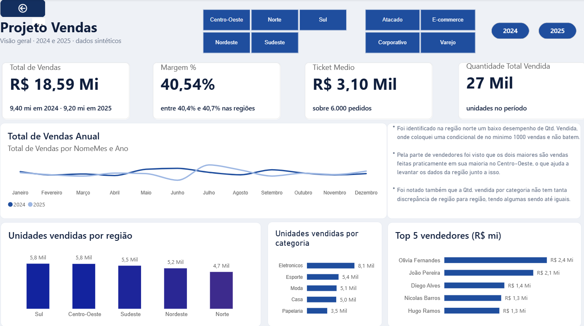
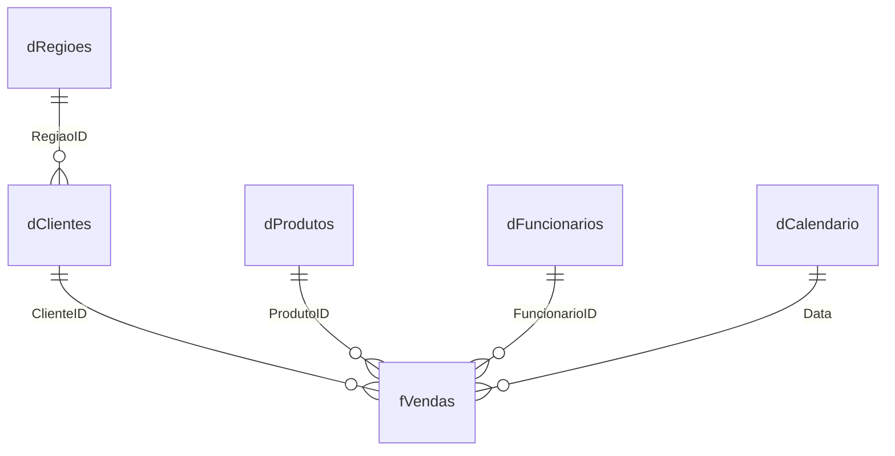

<div align="center">

# 📊 Projeto Vendas — Dashboard em Power BI

**Do dado bruto ao dashboard: importação, modelagem em esquema estrela, medidas DAX e storytelling com dados.**


</div>

---

## 📌 Sobre o projeto

O objetivo foi construir, do zero, um relatório de vendas que responde perguntas reais de negócio: **o que vendemos, onde, para quem, com que margem e em que época.**

O projeto cobre todo o fluxo de trabalho de um analista de dados:

1. **Extração e limpeza** dos dados com Power Query
2. **Modelagem** em esquema estrela (tabela fato + dimensões)
3. **Cálculos** com medidas em DAX, incluindo inteligência de tempo
4. **Visualização** em um dashboard interativo com segmentações

---

## 🖼️ Dashboard



---

## 🎯 Indicadores principais

| Indicador | Valor |
|---|---|
| 💰 Total de Vendas | R$ 18,59 mi |
| 📈 Margem | 40,54% |
| 🧾 Ticket Médio | R$ 3,10 mil |
| 📦 Quantidade Vendida | ~27 mil unidades |
| 🛒 Pedidos | 6.000 |
| 👥 Clientes | 300 |

---

## 🗂️ Dados

O arquivo `dataset_powerbi_vendas.xlsx` tem 6 abas, organizadas como um modelo dimensional:

| Tabela | Tipo | Linhas | Descrição |
|---|---|---|---|
| `fVendas` | Fato | 6.000 | Pedidos com data, quantidade, preço, desconto e valor total |
| `dClientes` | Dimensão | 300 | Cidade, estado, região e segmento do cliente |
| `dProdutos` | Dimensão | 47 | Categoria, subcategoria, custo e preço unitário |
| `dFuncionarios` | Dimensão | 15 | Vendedores, cargo e região de atuação |
| `dRegioes` | Dimensão | 5 | Regiões do Brasil |
| `dCalendario` | Dimensão | 731 | Calendário completo de 2024 a 2025 |

---

## 🧩 Modelo de dados

O modelo segue o **esquema estrela**: a tabela fato no centro e as dimensões ao redor, todas com relacionamento 1:N e filtro em direção única.



### 💡 Decisão de modelagem: o problema do `RegiaoID`

Tanto `dClientes` quanto `dFuncionarios` possuem um `RegiaoID`. Ligar `dRegioes` às duas tabelas cria um **loop** no modelo (dois caminhos diferentes até `fVendas`), o que gera ambiguidade nos filtros.

**Solução adotada:**

- `dRegioes` se conecta **apenas a `dClientes`**, porque a pergunta de negócio mais comum é *"em que região estão as vendas?"*.
- A região do vendedor foi trazida para dentro de `dFuncionarios` por um **Merge no Power Query**, como uma coluna de texto (`RegiaoFuncionario`), sem criar um segundo relacionamento ativo.

---

## 🔧 Transformações no Power Query

- Verificação e correção dos tipos de dados de todas as colunas
- Criação das colunas `ValorBruto` (quantidade × preço) e `MargemUnitaria` (preço − custo)
- Merge entre `dFuncionarios` e `dRegioes` para trazer a região do vendedor
- Agrupamento (Group By) para contar clientes por estado, em uma consulta auxiliar com carregamento desabilitado
- Nomenclatura em camadas: prefixo `f` para fatos e `d` para dimensões

---

## 🧮 Medidas DAX

As medidas estão organizadas em pastas de exibição: **Vendas**, **Custo e Margem**, **Tempo**, **Análise** e **Desconto**.

| Pasta | Medidas |
|---|---|
| Vendas | Total de Vendas, Quantidade Total Vendida, Ticket Médio, Nº de Pedidos, Nº de Clientes Distintos |
| Custo e Margem | Custo Total, Margem Total, Margem % |
| Tempo | Vendas Ano Anterior, Crescimento % vs Ano Anterior, Vendas YTD, Vendas Médias por Mês |
| Análise | Vendas Segmento Corporativo, % do Total de Vendas, Ranking de Produtos |
| Desconto | Desconto Médio, Desconto Médio Geral |

### Exemplos

```dax
Total de Vendas = SUM(fVendas[ValorTotal])
```

```dax
Ticket Médio =
DIVIDE([Total de Vendas], DISTINCTCOUNT(fVendas[PedidoID]))
```

```dax
Custo Total =
SUMX(fVendas, RELATED(dProdutos[CustoUnitario]) * fVendas[Quantidade])
```

```dax
Margem % = DIVIDE([Margem Total], [Total de Vendas])
```

```dax
Vendas Ano Anterior =
CALCULATE([Total de Vendas], SAMEPERIODLASTYEAR(dCalendario[Data]))
```

```dax
Crescimento % vs Ano Anterior =
DIVIDE([Total de Vendas] - [Vendas Ano Anterior], [Vendas Ano Anterior])
```

```dax
% do Total de Vendas =
DIVIDE([Total de Vendas], CALCULATE([Total de Vendas], ALLSELECTED()))
```

---

## 🔍 Principais insights

- **Eletrônicos** é a categoria que mais gera receita: **R$ 4,98 mi**.
- **Norte** tem a menor quantidade vendida (4.743 unidades), mas isso se explica pela **base menor de clientes** (51, contra 57 a 67 nas outras regiões). Por cliente, o volume de pedidos é praticamente igual em todas as regiões (cerca de 20).
- Os dois maiores vendedores, **Olívia Fernandes (R$ 2,4 mi)** e **João Pereira (R$ 2,1 mi)**, atuam no Centro-Oeste, onde fazem cerca de 89% das suas vendas.
- O **ticket médio varia pouco** entre segmentos: Corporativo (R$ 3.182) e Varejo (R$ 3.028) diferem em cerca de 5%.
- O **desconto médio é uniforme**: fica entre 6,76% e 7,23% em todas as regiões, sem nenhuma fora do padrão.
- **Domingo e sexta** são os dias mais fracos de vendas, em unidades, pedidos e valor.
- O pico de pedidos foi em **junho de 2024** (287) e **julho de 2025** (290).

---


[](https://www.linkedin.com/in/gabriel-mendonça-3613432b0)
[](https://github.com/gabrielmendonca7)
